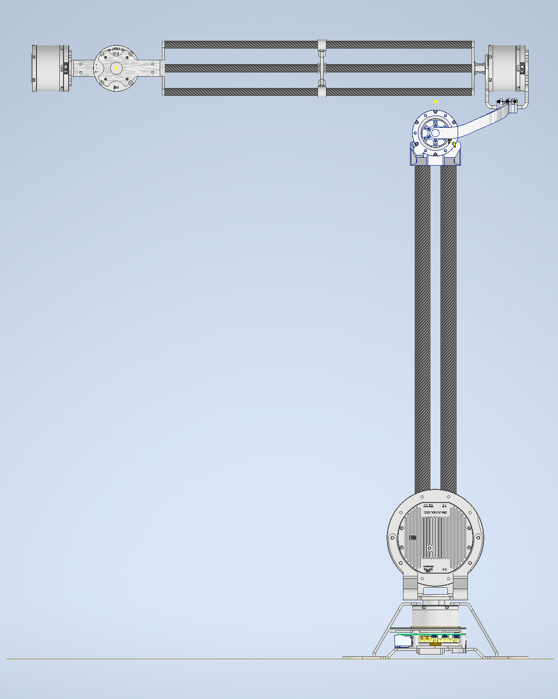

# FEIBOT

FEIBOT is a six-axis robotic arm prototype built around carbon-fiber tube links, motorized joints, and custom machined-part designs. This repository contains the mechanical design, the robot's kinematic model, and MATLAB tools for visualizing joint motion and analyzing tool reach.

  
  

*Current CAD design, shown in isometric and front views.*

## Hardware

Parallel carbon-fiber tubes form the main arm links. Custom brackets connect the links to the joint actuators, and the base provides mounting space for the control electronics.

| Design parameter | FEIBOT |
| --- | --- |
| Degrees of freedom | 6 revolute joints |
| Upper-arm span | 500 mm (J2 to J3) |
| Main forearm span | 405 mm (J4 to J5) |
| Target payload | 1 kg |
| Control architecture | Raspberry Pi 5 host with CAN communication to the joint actuators |

## Robot model and analysis

The URDF describes the joint axes, offsets, travel limits, and tool frame. The MATLAB viewer lets visitors explore joint configurations and inspect the tool pose. The workspace script uses forward kinematics over 50,000 sampled configurations to estimate the tool's positional reach within the modeled joint limits.

| Resource | Contents |
| --- | --- |
| [Mechanical CAD](ROBOT_CAD/) | Autodesk Inventor assembly, part files, drawings, and selected STEP models. |
| [URDF](kinematics/urdf/feibot.urdf) | Six-axis kinematic model. |
| [MATLAB joint viewer](kinematics/robot_viewer_ui.m) | Interactive joint controls and tool-pose visualization. |
| [Workspace analysis](kinematics/feibot_workspace.m) | Sampled reachability point cloud and planar projections. |

## Prototype status

Physical assembly is in progress. Coordinated six-axis motion and the 1 kg payload target are pending hardware validation.
