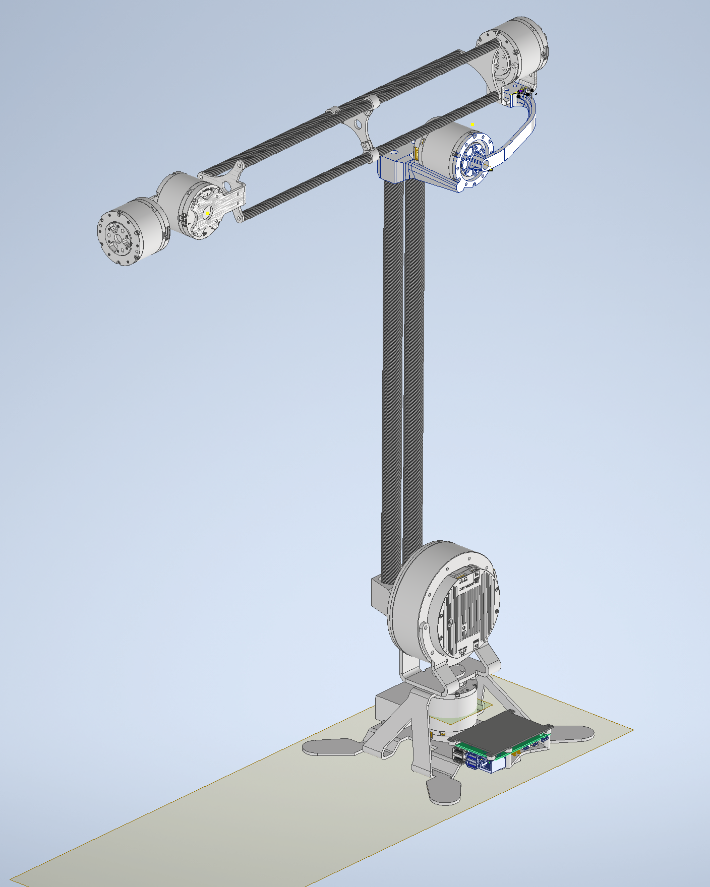

# FEIBOT

FEIBOT is a six-axis robotic arm I'm building to explore mechanical design, robot kinematics, and joint control. The project combines an Autodesk Inventor mechanical design, a URDF model, and MATLAB tools for visualizing joint motion and exploring the arm's workspace. Physical assembly is still in progress.

  
  

*Isometric and front views of the current CAD model.*

## Mechanical design

The arm uses carbon-fiber tube links, custom joint brackets, and a base with space for the Raspberry Pi 5 and supporting electronics. The upper arm spans about 500 mm from J2 to J3, and the main forearm span in the kinematic model is 405 mm. I evaluated parallel tubes for bending stiffness and explored placing the J4 actuator on the opposite side of the J3 axis to offset some of the forearm's gravitational torque.

A **1 kg payload** is a design target. The load and deflection estimates are based on modeled configurations. Payload capacity and sustained holding performance still need physical testing. [Browse the CAD files and selected engineering drawings](ROBOT_CAD/).

## Kinematics and workspace

The URDF describes six revolute joints, their axes and travel limits, and the tool frame. The interactive MATLAB viewer shows how individual joint movements change the arm's configuration and tool pose. The workspace script samples 50,000 joint configurations and uses forward kinematics to estimate where the tool can reach.

The current workspace estimate covers position reachability under joint limits. Collision clearance, payload effects, and the range of tool orientations available at each point remain to be evaluated. [View the URDF](kinematics/urdf/feibot.urdf) · [Browse the MATLAB scripts](kinematics/).

## Electronics and control

The control design uses a Raspberry Pi 5 as the host. I've evaluated the Damiao USB-to-CAN FD adapter and a multi-channel USB-CAN interface using SocketCAN. On the bench, one DM-J4310 actuator returned position, velocity, and torque feedback. Coordinated six-axis motion is still to be demonstrated.
